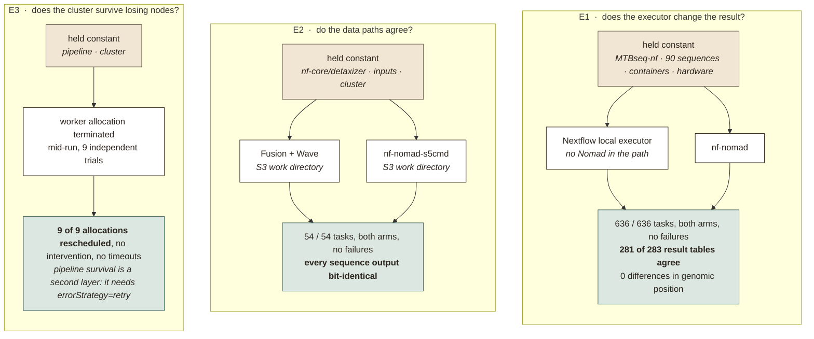

# nf-nomad manuscript assets

Deployment templates, validation configurations, measured results and a reviewer protocol for
nf-nomad, the Nextflow executor plugin for HashiCorp Nomad. It is the companion artefact to the
nf-nomad manuscript, and it lets the numbers reported there be re-measured.

## Start here

Three documents, in order, from a bare machine to the measurements the manuscript reports.

| | | |
|---|---|---|
| 1 | [Provision](protocol/01-provision.md) | bring up a cluster, either in containers on one machine or as a preemptible cloud fleet |
| 2 | [Run](protocol/02-run-pipeline.md) | run each experiment and collect its measurements |
| 3 | [Verify](protocol/03-expected-output.md) | what a correct run produces, with the reference numbers to compare against |

The local template is the intended starting point. It needs no cloud account, and it is also the
CI environment for the plugin itself.

## The three experiments

Each experiment holds everything constant except one variable, then compares the arms. These are
the results to reproduce; the datasets behind them are in `validation/results/`.

| | Reproduce with | Measured data |
|---|---|---|
| E1 | `x1-armA-local.config`, `x1-armB-nomad-posix.config` | [`X1-substrate-neutrality/`](validation/results/X1-substrate-neutrality/) |
| E2 | `x2-fusion.config`, `x2-s5cmd.config` | [`X2-mode-equivalence/`](validation/results/X2-mode-equivalence/) |
| E3 | `validation/scripts/preemption_trial.py` | [`X3-preemption/`](validation/results/X3-preemption/) |

## What is here

| Path | Contents |
|---|---|
| `templates/local-docker/` | One Nomad server and N clients as containers on a single machine. Docker is the only prerequisite. |
| `templates/cloud-gcp/` | A GCP preemptible spot fleet joined over an overlay network. This is where the preemption result is measured. |
| `templates/ARCHITECTURE.md` | Diagrams of what each template provisions. |
| `validation/configs/` | One Nextflow config per work-directory mode: shared POSIX, Fusion, nf-nomad-s5cmd. |
| `validation/pipelines/` | A synthetic sleep workload for exercising recovery. The reported preemption trials used the X1 pipeline, not this. |
| `validation/results/` | The measured datasets behind the manuscript, one directory per experiment. |
| `validation/scripts/` | Digest comparison, trace metrics, preemption timing. |
| `protocol/` | The three documents above. |

## Scope

These templates provision evaluation environments. They are not a production deployment system,
and they omit the multi-tenant policy, admission-control and audit layers a shared institutional
cluster needs.

## Credentials

Templates take their secrets at deploy time, from the environment or from `pulumi config set
--secret`. Committed configuration files carry placeholders. Runtime tokens written by the local
cluster are gitignored.

The published tree is clean. Earlier commits in this repository's history contained credentials,
which have been removed and rotated, so nothing in the history is a working value.

If you find something that looks like a live credential, please open an issue rather than a pull
request.

## Citing and licence

Archived on Zenodo, released under Apache-2.0 to match nf-nomad itself. See
[`CITATION.cff`](CITATION.cff).

## Related

- nf-nomad — <https://github.com/nextflow-io/nf-nomad>
- nf-nomad-s5cmd, the S3 work-directory provider
- The upstream `validation/` directory in the nf-nomad repository holds the per-feature
  configuration suite (constraints, directives, secrets, spread, volumes), which this repository
  does not duplicate.
