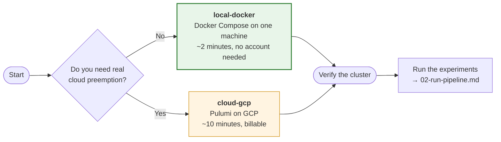

# 1 — Provision a cluster

Two paths. Take the first unless you specifically need to reproduce the preemption result on
real reclaimed capacity.



## Path A — `local-docker` (recommended)

One Nomad server and N clients as containers on a single machine. Docker is the only
prerequisite; there is no cloud account, no hypervisor and no cost.

```bash
cd templates/local-docker
CLIENTS=3 ./scripts/start.sh
```

The script builds the image, starts the cluster, bootstraps the ACL system and writes the
management token to `.nomad-token` (gitignored, never committed). Verify:

```bash
export NOMAD_ADDR=http://127.0.0.1:4646
export NOMAD_TOKEN=$(cat .nomad-token)
nomad node status        # expect 1 server + CLIENTS clients, all 'ready'
```

The server runs with `client { enabled = false }`, so stopping a client exercises rescheduling
rather than decapitating the cluster. That is what makes the preemption trials meaningful here.

Object-store modes additionally need MinIO, which is opt-in because the scheduling tests do not
stage data:

```bash
WITH_STORAGE=1 CLIENTS=3 ./scripts/start.sh
```

Stop and remove everything with `./scripts/stop.sh`.

## Path B — `cloud-gcp`

A persistent Nomad server plus a preemptible spot pool on GCP, joined over Tailscale. Use this
when the point is that GCP reclaims capacity on its own schedule rather than a script stopping a
container. Full instructions, including the configuration values you must supply, are in
[`../templates/cloud-gcp/gcp-infra/README.md`](../templates/cloud-gcp/gcp-infra/README.md).

## Two things that will look like bugs

**The cluster's namespace is not `default`.** The local template bootstraps into its own Nomad
namespace, so the Nomad UI opens on an empty view and CLI queries return nothing until you set
it. Export `NOMAD_NAMESPACE` alongside `NOMAD_ADDR` and `NOMAD_TOKEN`, or pass `-namespace` to
every command.

**On macOS the shared work directory must not live under `/tmp`.** `/tmp` is a symlink to
`/private/tmp`, so a path underneath it resolves to `/private/tmp/...` on the host while a Linux
task container knows only `/tmp`. Staged inputs then become dangling symlinks and tasks fail
with variations of "the file does not exist" while the allocation itself looks healthy. The
template picks a non-symlinked path per platform; override it with `NOMAD_SHARED_DIR` if you
need a different location. Whatever you choose, the host and container paths must be identical,
because the Nomad client launches task containers on the host daemon.

## Record the environment

Whichever path you took, capture what you ran on before you measure anything. Node count, CPU
and RAM per node, and the Nextflow, Nomad and `nf-nomad` versions all belong in the run record,
because none of the results below can be interpreted without them:

```bash
nomad node status -verbose
nextflow -version
nomad version
```

Next: [`02-run-pipeline.md`](02-run-pipeline.md).
