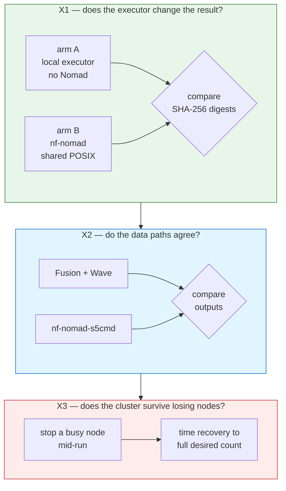

# 2 — Run the experiments

Four experiments, each isolating one variable. The configs in
[`../validation/configs/`](../validation/configs/) are env-driven, so none of them needs editing
before use.



Set the cluster address once, for every experiment:

```bash
export NOMAD_ADDR=http://127.0.0.1:4646          # or the GCP server's Tailscale IP
export NOMAD_TOKEN=$(cat templates/local-docker/.nomad-token)
```

## X0 — check the cluster runs anything at all

Before measuring, confirm the plugin works end to end on this cluster:

```bash
nextflow run nf-core/demo -profile test -c validation/configs/x1-armB-nomad-posix.config
```

If this fails, nothing below is interpretable. Fix it first.

## X1 — substrate neutrality

Both arms run the same pipeline over the same inputs on the same hardware. Only the executor
differs, which is what makes any output difference attributable to it.

```bash
# arm A — Nextflow's local executor, no Nomad in the path
nextflow run mtbseq-nf -c validation/configs/x1-armA-local.config \
  -with-trace -with-report -with-timeline

# arm B — the same pipeline through nf-nomad
nextflow run mtbseq-nf -c validation/configs/x1-armB-nomad-posix.config \
  -with-trace -with-report -with-timeline
```

Then compare the two output trees by digest rather than by eye:

```bash
python3 validation/scripts/output_digests.py <armA-outdir> <armB-outdir>
```

Run it twice: five samples for the timed comparison, and the full 90 for the digest claim. The
timed run must have both arms on one node, or the walltime numbers mean nothing.

## X2 — mode equivalence

Same executor, same cluster, different work-directory backend. Needs MinIO or another
S3-compatible endpoint reachable from every worker.

**Two settings are required before either command will work**, and both fail in ways that
point somewhere other than the cause:

```bash
export NXF_TEMP=/local/nxf-temp && mkdir -p /local/nxf-temp
```

`collectFile()` without a `storeDir` — the standard nf-core idiom for the workflow-summary
and methods YAMLs — builds its temporary directory *under* the work directory. On an
object-store work directory that `mkdir` fails and the run dies **before submitting a single
task**, reporting `Unable to create temporary directory`, which reads as a bucket permissions
problem. Verified: setting `NXF_TEMP` alone took a run from 0 tasks submitted to 95 completed.

Publish to a **local** `--outdir`, not `s3://`. Nextflow's own AWS SDK fails on `putObject`
retries against an S3 endpoint (`Content input stream does not support mark/reset, and was
already read once`). That is a defect in the publish path, unrelated to the mode under test,
and routing outputs locally removes it from the comparison.

```bash
nextflow run mtbseq-nf -c validation/configs/x2-fusion.config -with-trace --outdir <local-dir>
nextflow run mtbseq-nf -c validation/configs/x2-s5cmd.config  -with-trace --outdir <local-dir>
python3 validation/scripts/output_digests.py <fusion-outdir> <s5cmd-outdir>
```

Run the two arms **sequentially**, not concurrently. Run together they compete for cores and
object-store bandwidth, and neither arm then experiences the conditions the other did.

The `nf-nomad-s5cmd` arm additionally needs four things set, each of which fails quietly if
missed: the plugin present in the `plugins` block; `enabled` + `workDir.enabled` +
`workDir.bucket`; an explicit `nomad.s5cmd.s3` block (it is **not** inherited from Nextflow's
`aws` scope, and without an endpoint s5cmd addresses real AWS); and a `binary` path that
resolves identically in the head and in task containers. The plugin's own README lists the
symptom each produces.

## ⚠ The `s3://` endpoint-override trap

Setting `aws.client.endpoint` to a private object store redirects **every** `s3://` URI in the
run, including public-AWS paths that nf-core `test_full` profiles use for reference genomes
and samplesheets. Nextflow then looks for public objects on your own store and aborts at
parameter validation in seconds:

```
* --input (…/samplesheet.full.csv): Validation of file failed:
    -> Entry 1: … 's3://ngi-igenomes/test-data/mag/ERR3201918_1.fastq.gz' does not exist
```

It reads like a broken pipeline. It is a routing problem. Give public inputs as HTTPS URLs, or
stage them locally first and reference the local paths — the latter also removes a large,
truncation-prone download from the middle of a long run:

```bash
curl -s https://raw.githubusercontent.com/nf-core/test-datasets/<branch>/samplesheets/<sheet>.csv \
  | sed 's#s3://ngi-igenomes/#https://ngi-igenomes.s3.eu-west-1.amazonaws.com/#g' > sheet.https.csv
```

Grep the resolved profile for `s3://` before launching anything long. `-profile test` is
unaffected; its data is fetched over HTTPS already.

## X3 — preemption resilience

Start a long-running workload, then take nodes away underneath it. The synthetic pipeline exists
so that kills land at random points in task lifetimes rather than always at the same moment:

```bash
nextflow run validation/pipelines/nf-sleep-random \
  --tasks 40 --min-sec 20 --max-sec 90 --seed 42 -c validation/configs/x1-armB-nomad-posix.config &

cd templates/local-docker
TRIALS=10 JOB=<nomad-job-name> ./scripts/chaos.sh
```

`chaos.sh` writes one row per trial to `trials.tsv`. Read its header before trusting a number —
it records how recovery is defined, and it deliberately marks trials that failed to disrupt any
work as `NO_DISRUPTION` and excludes them, rather than counting them as instant recoveries.

## X4 — placement latency

No separate run. Derive it from the traces X1 and X2 already produced:

```bash
python3 validation/scripts/trace_metrics.py <trace-file> ...
```

Next: [`03-expected-output.md`](03-expected-output.md).
