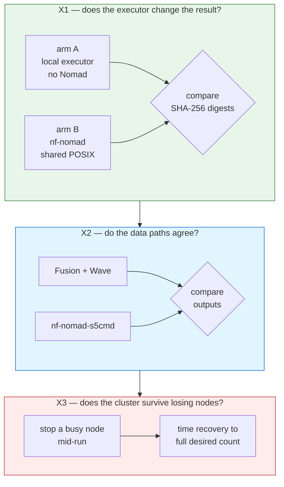

# 2 — Run the experiments

**Pipeline revisions are pinned below and should stay pinned.** The `-r` flags name the
exact revisions the deposited results were produced from: `mycobactopia-org/MTBseq-nf`
`v1.0.0` for X1 and `nf-core/detaxizer` `1.3.0` for X2. Dropping `-r` resolves the default
branch instead, which moves, so the digest manifests would be compared against a different
pipeline than the one that produced them. The single exception is the X0 cluster check,
which is recorded as having run `nf-core/demo -r dev`; `dev` is a branch rather than a tag,
but X0 only establishes that the cluster places and runs work at all, and nothing in the
paper depends on its outputs.

Four experiments, each isolating one variable. The configs in
[`../validation/configs/`](../validation/configs/) are env-driven, so none of them needs editing
before use.



Set the cluster address once, for every experiment:

```bash
export NOMAD_ADDR=http://127.0.0.1:4646          # or the GCP server's Tailscale IP
export NOMAD_TOKEN=$(cat templates/local-docker/.nomad-token)
```

## X0 — check the cluster runs anything at all

Before measuring, confirm the plugin works end to end on this cluster:

```bash
nextflow run nf-core/demo -r dev -profile test,docker -c validation/configs/x1-armB-nomad-posix.config
```

If this fails, nothing below is interpretable. Fix it first.

## X1 — substrate neutrality

Both arms run the same pipeline over the same inputs on the same hardware. Only the executor
differs, which is what makes any output difference attributable to it.

```bash
# arm A — Nextflow's local executor, no Nomad in the path
nextflow run mycobactopia-org/MTBseq-nf -r v1.0.0 -c validation/configs/x1-armA-local.config \
  -with-trace -with-report -with-timeline

# arm B — the same pipeline through nf-nomad
nextflow run mycobactopia-org/MTBseq-nf -r v1.0.0 -c validation/configs/x1-armB-nomad-posix.config \
  -with-trace -with-report -with-timeline
```

Then compare the two output trees by digest rather than by eye:

```bash
python3 validation/scripts/output_digests.py <armA-outdir> <armB-outdir>
```

Run it twice: five samples for the timed comparison, and the full 90 for the digest claim. The
timed run must have both arms on one node, or the walltime numbers mean nothing.

## X2 — mode equivalence

Same executor, same cluster, different work-directory backend. Needs MinIO or another
S3-compatible endpoint reachable from every worker.

Set `NXF_TEMP` to a local path before running either arm:

```bash
export NXF_TEMP=/local/nxf-temp && mkdir -p /local/nxf-temp
```

Without it the run fails before submitting any task, reporting `Unable to create temporary
directory`. The cause is `collectFile()`, which nf-core pipelines call without a `storeDir`
for the workflow-summary and methods YAMLs. It creates its temp directory inside the work
directory, and that mkdir fails on an object store. Setting `NXF_TEMP` alone took one run
from 0 tasks to 95.

Publish to a local `--outdir` rather than `s3://`. Nextflow's AWS SDK fails on `putObject`
retries against an S3 endpoint with `Content input stream does not support mark/reset, and
was already read once`. That is a bug in the publish path rather than in the work-directory
mode, so keeping outputs local keeps it out of the comparison.

```bash
nextflow run nf-core/detaxizer -r 1.3.0 -profile test -c validation/configs/x2-fusion.config -with-trace --outdir <local-dir>
nextflow run nf-core/detaxizer -r 1.3.0 -profile test -c validation/configs/x2-s5cmd.config  -with-trace --outdir <local-dir>
python3 validation/scripts/output_digests.py <fusion-outdir> <s5cmd-outdir>
```

Run the arms one after the other. In parallel they compete for cores and object-store
bandwidth, so neither runs under the conditions of the other.

The s5cmd arm needs four settings. Missing any of them fails quietly:

- `nf-nomad-s5cmd` in the `plugins` block
- `enabled`, `workDir.enabled` and `workDir.bucket`
- an explicit `nomad.s5cmd.s3` block. It is not inherited from Nextflow's `aws` scope, and
  with no endpoint set s5cmd talks to real AWS
- a `binary` path that resolves in the head and in the task containers

The plugin README lists the symptom each one produces.

## The `s3://` endpoint-override trap

`aws.client.endpoint` applies to every `s3://` URI in the run, including public AWS paths.
nf-core `test_full` profiles use those for reference genomes and samplesheets, so Nextflow
looks for public objects on your own store and aborts at parameter validation:

```
* --input (…/samplesheet.full.csv): Validation of file failed:
    -> Entry 1: … 's3://ngi-igenomes/test-data/mag/ERR3201918_1.fastq.gz' does not exist
```

Give public inputs as HTTPS URLs, or download them first and reference local paths.
Downloading first also avoids a multi-gigabyte transfer part-way through a long run:

```bash
curl -s https://raw.githubusercontent.com/nf-core/test-datasets/<branch>/samplesheets/<sheet>.csv \
  | sed 's#s3://ngi-igenomes/#https://ngi-igenomes.s3.eu-west-1.amazonaws.com/#g' > sheet.https.csv
```

Check the resolved profile for `s3://` before starting a long run. `-profile test` is not
affected, since its data comes over HTTPS.

## X3 — preemption resilience

Start a workload, then take allocations away underneath it. The deposited trials were produced
on the X1 five-sample parallel workflow and its 41 tasks, not on a synthetic one, so reproduce
them that way:

```bash
nextflow run mycobactopia-org/MTBseq-nf -r v1.0.0 -c validation/configs/x1-armB-nomad-posix.config \
  --input <5-sample sheet> --parallel true &

python3 validation/scripts/preemption_trial.py \
  --job-prefix <task-job-prefix> --trials 10 --execute --out S4-preemption.tsv
```

`--job-prefix` scopes every kill to the one pipeline run, and the harness aborts rather than
continuing if a candidate job name matches a platform service. `--execute` is required; the
default is a dry run that prints the candidates and changes nothing.

Run the trials twice, once under Nextflow's default error handling and once with
`errorStrategy = 'retry'`. The deposited data is both runs together, four trials and five, in
`S4-preemption-noretry.tsv` and `S4-preemption-retry.tsv`. The two configurations are what
separate allocation recovery from pipeline survival, which is the finding rather than a detail
of the method.

Trials that failed to disrupt any running work are recorded as invalid and excluded, rather
than counted as instant recoveries. The manifests keep the harness's own numbering, so the
excluded attempts hold their positions and the nine valid trials are numbered 2 to 10.

Two other pieces sit nearby and measure something else. `templates/local-docker/scripts/chaos.sh`
stops a whole client container and times the job back to its full running count, which is node
loss rather than the loss of one task, and it writes `trials.tsv`. `validation/pipelines/nf-sleep-random`
is a synthetic workload whose tasks sleep for seeded random durations, so kills land at varied
points in a task lifetime; it computes nothing, so it can show recovery but never correctness.
Neither produced the reported numbers.

## X4 — placement latency

No separate run. Derive it from the traces X1 and X2 already produced:

```bash
python3 validation/scripts/trace_metrics.py <trace-file> ...
```

Next: [`03-expected-output.md`](03-expected-output.md).
