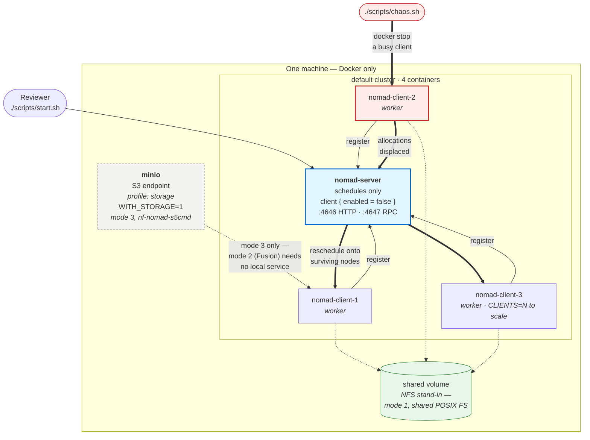

# Template architecture

Diagrams of what each template actually provisions, drawn from the code in this repository
rather than from the manuscript text. Where the two disagree, the disagreement is noted.

The repository ships two templates. `local-docker/` is the reviewer path, a Docker Compose
cluster that needs nothing but Docker. `cloud-gcp/` shows the same plugin against preemptible
cloud capacity, which is what the resilience claim is measured on.

---

## `local-docker/`, the reviewer artefact ★

Start here. One machine, Docker only, no cloud account and no credentials. This is the
path a reviewer takes, and it is the only template verified end to end (2026-08-06).

Figure. The local cluster and a reallocation trial. The server schedules but runs nothing
(`client { enabled = false }`), so stopping a client exercises rescheduling rather than
decapitating the cluster. Clients are replicas of one image, scaled with `CLIENTS=N`; each
registers to the server and mounts a shared Docker volume that stands in for NFS, which is what
makes the shared-POSIX work-dir mode demonstrable locally. Mode numbering follows Figure 1 of
the manuscript: 1 = shared POSIX FS, 2 = Fusion + Wave, 3 = `nf-nomad-s5cmd`. MinIO is opt-in
(`profile: storage`) because it serves mode 3 only, and because the reallocation test is pure
scheduling, nothing stages data, so the default cluster is four containers. The heavy arrows trace one `chaos.sh` trial: stop a busy
client, its allocations are displaced, the scheduler places them on the survivors, and recovery
is timed from the stop to the job regaining its desired count.

| Verified 2026-08-06 | |
|---|---|
| Cluster | 1 server + 3 clients ready, no object store |
| Placement | 6-allocation job spread 3 / 2 / 1 |
| Recovery | 4 trials, **median 26 s** (24, 26, 26, 27) |

Compared with upstream's `docker/`, which runs a **single agent that is both server and
client** and therefore cannot reschedule anything at all, the only structural change here is
splitting those roles. Nomad version, ACL flow and `s5cmd` path are kept identical so the two
do not drift.

---

## `cloud-gcp/gcp-infra/`, GCP tier with an overlay-joined spot pool

Provisions its own VPC, a Nomad server and clients, and a preemptible spot pool. Nodes join a
Tailscale mesh, which is what allows this tier to share one Nomad cluster with nodes elsewhere.

The spot pool is where GCP reclaims capacity on its own schedule, and the executor must
reschedule the affected tasks. The E3 reported in the manuscript was measured differently, by
stopping single task allocations on the institutional cluster; see
`../validation/results/E3-preemption-recovery/`. MinIO and the NFS volume are the two work-directory
backends; Fusion needs neither, only network reach to an object store.

---

## `cloud-gcp/spot-compute/`, elastic capacity for an existing cluster

Standalone, and distinct from `gcp-infra`: it adds spot capacity to a cluster that already
exists rather than creating one. Isolated Pulumi state, no shared resources.

The autoscaler reads Nomad's APM over the overlay and resizes the MIG. The instances are SPOT,
so preemption is expected behaviour rather than a fault, which is what makes this the right
substrate for the resilience claim.

---

## Which template serves which experiment

| Experiment | Template | Status |
|---|---|---|
| **X0** provision + profile | **`templates/local-docker`** (Docker Compose) | ready |
| **E1** substrate neutrality | `sun-aither` (existing cluster) | ready |
| **E2** mode equivalence | `gcp-infra` (MinIO + Fusion) | ready |
| **E3** preemption | any running cluster, with `validation/scripts/preemption_trial.py`; measured on the institutional cluster | ready |

The local path is the one a reviewer without cloud credentials reaches for first, and it is now
the verified one (2026-08-06). The cloud templates are reviewable as code but their at-scale
results are still to be generated; see the experiment handover for what each must produce.
