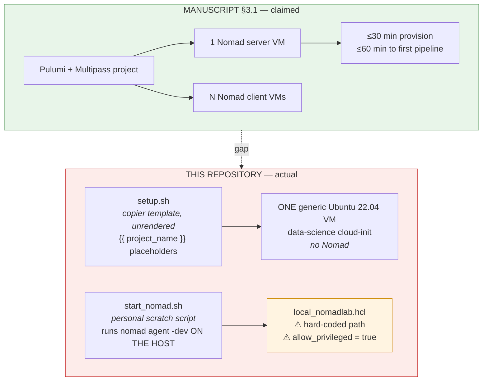
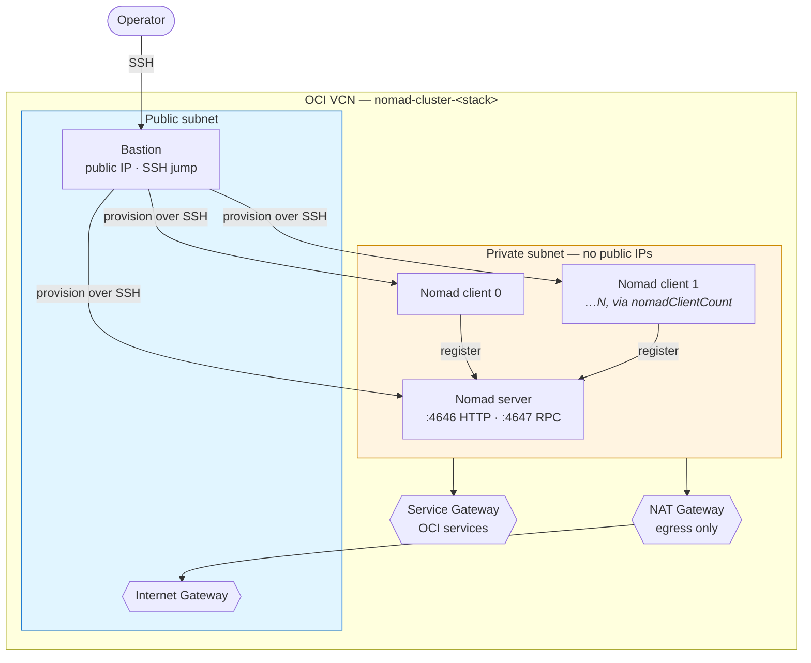
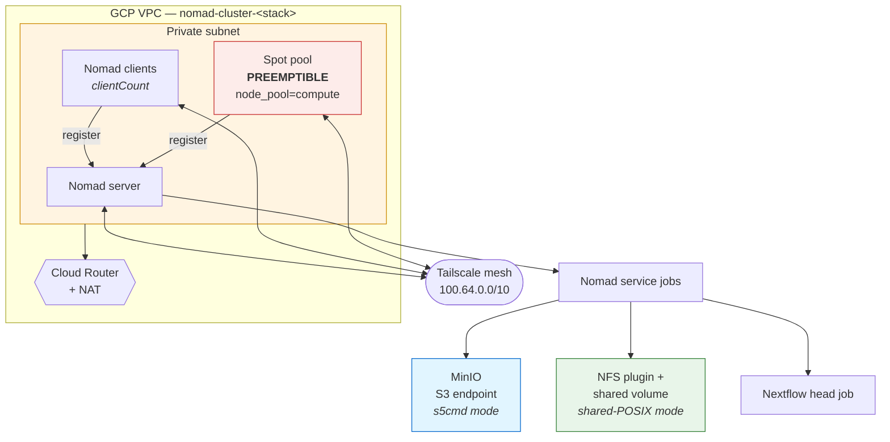
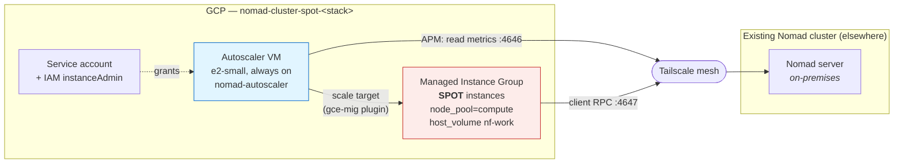

# Template architecture

Diagrams of what each template actually provisions, drawn from the code in this repository
rather than from the manuscript text. Where the two disagree, the disagreement is noted.

---

## ⚠ `local-multipass/` — does not yet provision a cluster

**Read this before reviewing the local template.** The manuscript (§3.1, Supplementary S1)
describes *"a Pulumi + Multipass project [that] provisions a 1-server + N-client Nomad cluster
on a single laptop (≥16 GB RAM) in under 30 minutes"*. **No such project exists in the source
tree.** What is here is two unrelated pieces:

Three specific defects:

1. **`setup.sh` is an unrendered copier template.** It still carries `{{ project_name }}`,
   `{{ multipass_memory }}` and similar placeholders, and it launches **one** general-purpose
   VM. It does not install or configure Nomad.
2. **`start_nomad.sh` runs on the host, not in VMs.** It calls `nomad agent -dev` under
   `/usr/local/bin/bash` with commented-out `nextflow run` lines. It is a developer scratch
   file, not a provisioning script.
3. **`local_nomadlab.hcl` will not work for anyone else.** It hard-codes an absolute path from
   the author's machine as a `host_volume`, and it sets `allow_privileged = true` plus
   `"docker.priviledged.enabled" = "true"` (note the typo, which means that second key does
   nothing). **The privileged default contradicts §2.1**, which states that Docker task-driver
   configuration defaults to non-privileged.

Since §3.1 calls this template *"the canonical reviewer artefact"*, closing this gap is a
submission blocker, not a polish item. It is X0 in the experiment handover.

---

## `cloud-oci-gcp/oracle-infra/` — OCI persistent tier

Real and complete. Provisions an isolated VCN with a public bastion and a private Nomad tier;
workers have no public addresses and egress through a NAT gateway.

Security lists restrict the private subnet to `10.0.1.0/24` on SSH, 4646 and 8080. Client count
is `nomadClientCount` (default 2).

---

## `cloud-oci-gcp/gcp-infra/` — GCP tier with an overlay-joined spot pool

Provisions its own VPC, a Nomad server and clients, and a preemptible spot pool. Nodes join a
Tailscale mesh, which is what allows this tier to share one Nomad cluster with nodes elsewhere.

The spot pool is where **X3 preemption trials** run: instances are reclaimed by GCP, and the
executor must reschedule the affected tasks. MinIO and the NFS volume are the two work-directory
backends; Fusion needs neither, only network reach to an object store.

---

## `cloud-oci-gcp/spot-compute/` — elastic capacity for an existing cluster

Standalone, and distinct from `gcp-infra`: it adds spot capacity to a cluster that already
exists rather than creating one. Isolated Pulumi state, no shared resources.

The autoscaler reads Nomad's APM over the overlay and resizes the MIG. The instances are SPOT,
so preemption is expected behaviour rather than a fault — which is what makes this the right
substrate for the resilience claim.

---

## Which template serves which experiment

| Experiment | Template | Status |
|---|---|---|
| **X0** provision + profile | `local-multipass` | ⚠ **blocked** — template does not provision a cluster |
| **X1** substrate neutrality | `sun-aither` (existing cluster) | ready |
| **X2** mode equivalence | `gcp-infra` (MinIO + Fusion) | ready |
| **X3** preemption, 10 trials | `gcp-infra` spot pool, or `spot-compute` | ready |

The cloud path is reviewable now. The local path — the one a reviewer without cloud credentials
would reach for first — is the gap.
