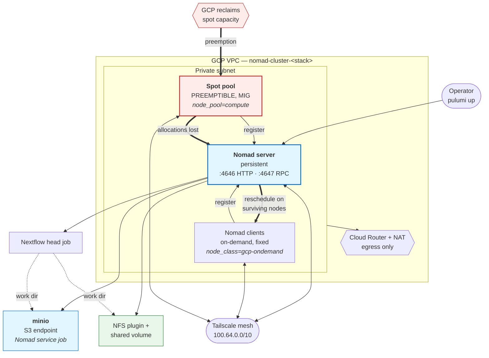

# `gcp-infra` — a Nomad cluster on GCP with a preemptible spot pool

Provisions a self-contained Nomad cluster on Google Cloud Platform: one persistent server, a
fixed pool of on-demand clients, and a preemptible spot pool that GCP may reclaim at any time.
Nodes join a Tailscale mesh, which is what lets the same cluster span this tier and hardware
elsewhere.

This is the template the resilience result is measured on. Preemption here is not simulated —
GCP reclaims spot instances on its own schedule, and the executor has to cope.



**Figure. The GCP tier.** The server is persistent and the spot pool is not. When GCP reclaims a
spot instance the allocations on it are lost, the scheduler places them on surviving nodes, and
the pipeline continues. MinIO and the NFS volume are the two work-directory backends; Fusion
needs neither, only network reach to an object store.

## Prerequisites

| | |
|---|---|
| Pulumi | ≥ 3.0, with a state backend configured |
| Node.js | ≥ 18 (this is a TypeScript Pulumi project) |
| `gcloud` | authenticated, with a project that has Compute Engine enabled |
| Tailscale | an account, and an auth key you can generate at deploy time |

## Deploy

```bash
cd templates/cloud-gcp/gcp-infra
npm install
```

Set your own values. Nothing site-specific is committed, so every one of these is required:

```bash
pulumi stack init dev
pulumi config set gcp:project <YOUR_GCP_PROJECT_ID>
pulumi config set gcp:region africa-south1
pulumi config set --secret gcp-typescript:tailscaleKey <YOUR_TAILSCALE_AUTH_KEY>
```

Size the cluster. The spot pool is the part that matters for the resilience test:

```bash
pulumi config set gcp-typescript:nomadClientCount 1
pulumi config set gcp-typescript:spotPoolMaxSize 3
```

Then bring it up:

```bash
pulumi up
```

Provisioning takes roughly ten minutes, most of it waiting for instances to boot and join the
Tailscale mesh. When it finishes, confirm the cluster formed:

```bash
export NOMAD_ADDR=http://<server-tailscale-ip>:4646
nomad node status          # server plus clients, all 'ready'
nomad server members       # one server, alive
```

## Run the storage-plane services

The work directory needs a backend. For the object-store modes, start MinIO as a Nomad service
job; for the shared-filesystem mode, register the NFS plugin and volume instead:

```bash
nomad job run scripts/minio.hcl                 # object-store modes
# or
nomad job run scripts/nfs-plugin.hcl
nomad volume create scripts/shared-storage.volume.hcl
```

## Run a pipeline

`nextflow.gcp.config` selects the `nomad` executor and reads every site value from the
environment, so it needs no editing:

```bash
export NOMAD_ADDR=http://<server-tailscale-ip>:4646
export NOMAD_TOKEN=<your-acl-token>
nextflow run nf-core/demo -profile test -c nextflow.gcp.config
```

To run the head job inside the cluster rather than from your workstation, submit
`scripts/nextflow-head.hcl` and use `nextflow.headjob.config`.

## Tear down

```bash
pulumi destroy
```

Spot instances are billed while they exist. Destroy the stack when a campaign finishes.

## What to do next

To reproduce the measurements the manuscript reports on this template, follow
[`../../../protocol/`](../../../protocol/), which covers provisioning, running each experiment,
and what the output should look like.
