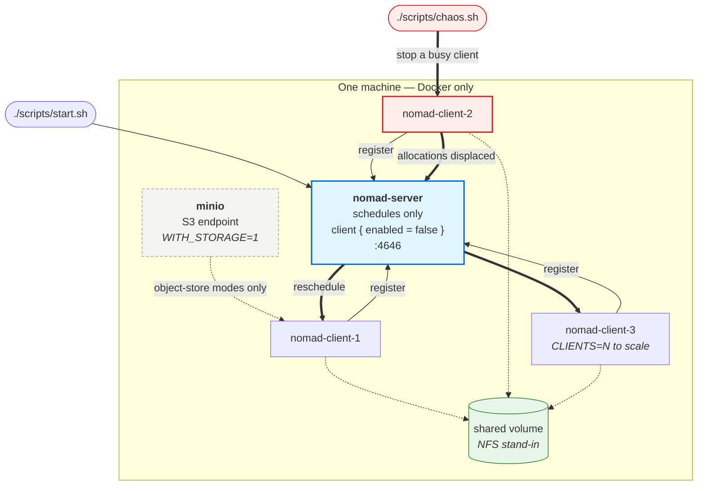

# Local Nomad cluster, the reviewer artefact

One command brings up a multi-node Nomad cluster with an S3 endpoint, on any machine with
Docker. No cloud account, no VM layer, no credentials.

```bash
./scripts/start.sh                  # server + 3 clients
./scripts/chaos.sh                  # stop a client mid-run (reallocation trial)
./scripts/stop.sh

WITH_STORAGE=1 ./scripts/start.sh   # adds MinIO, only needed for the s5cmd mode
CLIENTS=5 ./scripts/start.sh        # more nodes
```

No object store by default. The cluster-level test is scheduling and reallocation, nothing stages data, so MinIO sits behind a compose profile and the default cluster is
four containers rather than five. It is opt-in for X2, where the s5cmd work-dir mode
needs an S3 endpoint.

Architecture diagram: [`../../templates/ARCHITECTURE.md`](../../templates/ARCHITECTURE.md)
shows the topology and traces one reallocation trial.




Figure. The local cluster and one reallocation trial. The server schedules but runs nothing,
so stopping a client exercises rescheduling rather than killing the cluster. Clients are replicas
of one image, scaled with `CLIENTS=N`. MinIO is opt-in because the scheduling tests stage no data.

## Why containers

The nf-nomad project already tests against a containerised Nomad in its own CI
(`docker/` upstream). For a reviewer that is the lowest-friction route: no hypervisor,
no VM images, no cloud provider, and it behaves identically on macOS, Linux and Windows.
This directory is a minimal, multi-node derivative of that upstream setup.

## What it adds over upstream

Upstream's compose file runs a single agent that is both server and client
(`bootstrap_expect = 1`, `name = "client_dev"`). That is sufficient for functional tests but
cannot demonstrate rescheduling, because there is no second node to reschedule onto.

This variant separates the roles:

| | upstream `docker/` | here |
|---|---|---|
| Topology | 1 agent, server + client | 1 server + **N client containers** |
| Scaling | fixed | `CLIENTS=5 ./scripts/start.sh` |
| Node loss | not possible | `./scripts/chaos.sh` stops a client |
| Purpose | functional / CI | **X3 preemption trials**, plus X0 and X2 |

Everything else is kept deliberately close to upstream so the two do not drift: same Nomad
version, same ACL bootstrap, same MinIO service, same `s5cmd` binary location.

## Verified 2026-08-06

Brought up and exercised end to end on Docker Desktop 24.0.2, 8 CPU / 16 GB, macOS.

| | |
|---|---|
| Cluster | 1 server + 3 clients, all `ready` (MinIO not required) |
| Placement | a 6-allocation job spread across all three clients |
| Recovery | **4 trials, median 26 s** (24, 26, 26, 27) — node stopped, allocations displaced, job back to 6/6 on survivors |
| Storage-free | the last trial ran on a cluster with **no object store at all**, confirming reallocation needs only the scheduler |

`trials.tsv` holds the rows. n=3 is a check, not a result. X3 calls for 10 trials
against the randomised workload rather than a fixed-duration sleeper.

## What each experiment gets

| | |
|---|---|
| **X0** provision + first pipeline | time `start.sh` → first completed pipeline |
| **X2** mode equivalence | `WITH_STORAGE=1` brings up MinIO for the s5cmd mode; Fusion needs only network reach |
| **X3** preemption | `chaos.sh` stops a client mid-run; measure reschedule latency |

X1 (substrate neutrality) needs real hardware and stays on the institutional cluster.

## What this is not

A production deployment. Single server, no Raft quorum, ACLs bootstrapped to a throwaway
token, MinIO with default credentials on a private Docker network. It is an evaluation
environment, and the cloud templates under `templates/` document the at-scale topology.
